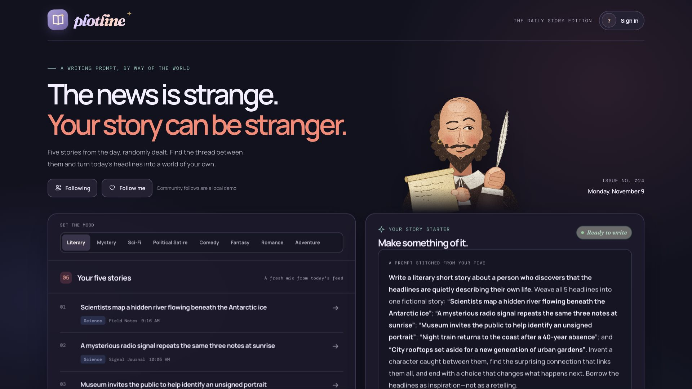

# Plotline

**Five headlines from the day, randomly dealt, become one original fiction-writing prompt.**

Plotline is a writing-prompt app for people who want to write but don't know where to start. Pick a mood, get five news stories, and Plotline stitches them into a single story starter. Then write it in the built-in editor.

### ▶ [Try it live](https://plotline-bryan.netlify.app)



Designed and built by **Bryan Burrows** with AI coding assistants. It's part of my AI product and UX design portfolio.

---

## Features

- **Eight moods.** Choose Literary, Mystery, Sci-Fi, Political Satire, Comedy, Fantasy, Romance or Adventure. Each has its own set of prompt templates.
- **Five stories, one prompt.** Plotline deals five headlines and weaves them into one writing prompt. Shuffle for a new hand, or copy the prompt.
- **Live satire headlines.** The Political Satire mood pulls real headlines from The Onion, Babylon Bee, The Hard Times and The Daily Mash. If a feed is down it falls back to another source. Comedy, Fantasy, Romance and Adventure deal made-up headlines written for that mood.
- **A writing room.** A rich-text editor with formatting, lists, links, images, tables, text and highlight colours, word counts and a "Get me started" opening-line helper.
- **Keep your work.** Drafts autosave in the browser. You can download a story as an editable HTML file or print it to PDF.
- **Share it.** Ready-made sharing flows for Facebook, X, Instagram and TikTok.
- **Community demo.** Writer profiles, a "Most Read" list and follows show how a community layer could work. These run locally as a demo.
- **Optional cloud journal.** With Firebase configured, signed-in writers get a private journal that syncs across devices, with conflict handling when two devices edit the same entry. Until a Firebase project is connected, the sign-in buttons stay hidden and Plotline saves drafts on the device only.

## How it was built

I led the product and UX design: the concept, the flows, the visual direction and the copy. I built the app with AI coding assistants. I directed the work in small, reviewable steps and tested each change in the browser before keeping it.

Some design decisions:

- **Constraint as a creative tool.** Five random headlines give writers enough to spark an idea, but not so much that the prompt feels prescriptive. The prompt asks writers to *borrow* the headlines, not retell them.
- **Low-friction start.** You don't need an account to write. Sign-in only adds sync, and your local draft moves into your journal the first time you sign in.
- **Reliable feeds.** Publishers block cross-site requests, so Netlify fetches the RSS feeds on the app's behalf (see [`netlify.toml`](netlify.toml) and [`netlify/functions/satire-feed.mjs`](netlify/functions/satire-feed.mjs)). There are two fallbacks after that.

## Tech stack

- HTML, CSS and vanilla JavaScript in a single `index.html`, with no framework or build step
- [Netlify](https://www.netlify.com/) for hosting, proxy redirects and one serverless function for the RSS feeds
- [Firebase](https://firebase.google.com/) Authentication and Cloud Firestore for the optional journal sync, protected by [`firestore.rules`](firestore.rules)
- SVG illustrations of Shakespeare in [`assets/`](assets)

## Run it locally

```bash
git clone https://github.com/BryantheBurrows/Plotline.git
cd Plotline
npx serve .
```

Then open the address it prints (usually http://localhost:3000).

- The writing tools and curated headlines work on any static server.
- The live satire feeds need the Netlify redirects and function. To run those locally, use the [Netlify CLI](https://docs.netlify.com/cli/get-started/): `npx netlify-cli dev`.
- The cloud journal needs your own Firebase project. Follow [FIREBASE_SETUP.md](FIREBASE_SETUP.md). Until then the app keeps drafts in the browser.

## Project structure

```
Plotline/
├── index.html                       The whole app: markup, styles and scripts
├── assets/                          Shakespeare SVG illustrations
├── netlify.toml                     Netlify settings and RSS proxy redirects
├── netlify/functions/satire-feed.mjs  RSS fetcher for feeds that need redirects followed
├── firestore.rules                  Firestore security rules for the journal
├── FIREBASE_SETUP.md                How to connect your own Firebase project
└── docs/screenshot.jpg              Screenshot used in this README
```

## Credits

- Product, UX design and direction: **Bryan Burrows**
- Built with help from AI coding assistants
- Satire headlines belong to their publishers. Plotline links back to every original article.

## License

[MIT](LICENSE)
